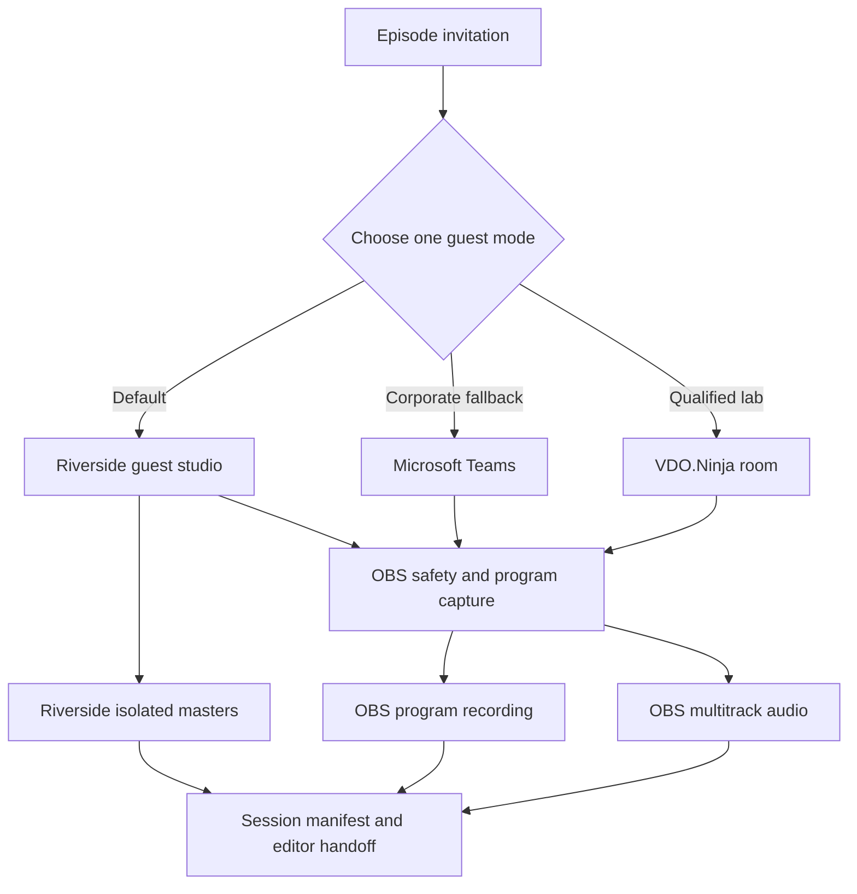
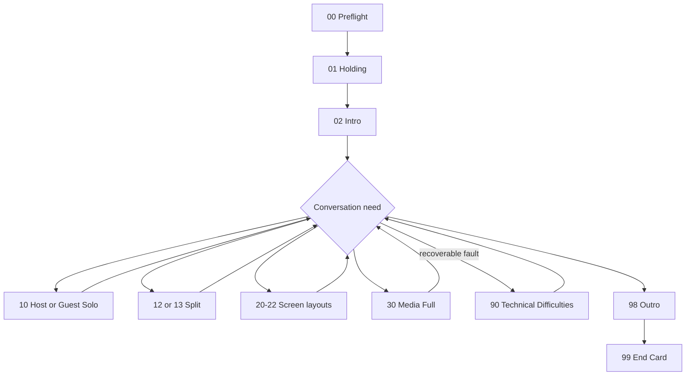

# Remote Podcast Studio - Plan

## Goal Capsule

- **Objective:** A nontechnical corporate guest can join one familiar link and complete a professionally recorded remote podcast without experimenting with production tools.
- **Means:** Build one reusable OBS production system with Riverside as the default capture mode, Microsoft Teams as the corporate fallback, and VDO.Ninja as the experimental owned mode. (KTD1, KTD2)
- **Authority:** Guest simplicity and recoverable recordings outrank live visual sophistication and automation.
- **Execution profile:** Configuration, browser-overlay assets, runbooks, and controlled OBS mutations in a disposable scene collection before production use.
- **Stop conditions:** Stop before touching an existing production scene collection, starting a recording or virtual camera, buying a subscription, or installing a plugin that has not been separately approved.
- **Owner:** The implementing agent prepares and verifies the tooling; the show owner approves branding and promotes a tested setup to production.

---

## Product Contract

### Summary

Create a reusable remote-podcast kit around OBS that separates the guest experience from the production machinery.
The host chooses one of three operating modes before each session.
All modes share the same visual language, audio map, preflight checklist, recovery procedure, and output folder convention.

### Problem Frame

Browser studios such as StreamYard reduce operator effort, but their useful branded plans add recurring cost.
Riverside provides a simpler guest path and locally recorded participant tracks at a lower entry price, while OBS and VDO.Ninja provide more control at the cost of setup and operational risk.
Corporate guests introduce another constraint: their organization may block unfamiliar browser services while already permitting Microsoft Teams.

The system must therefore absorb experimentation on the host side.
The guest must never be asked to join two calls, configure OBS, install a plugin, or debug an experimental path during the interview.

### Key Decisions

- **Build both the dependable and owned paths.** Riverside remains the default while OBS plus VDO.Ninja is qualified separately. Governs R1, R2, R8. (session-settled: user-directed — chosen over a single-platform setup: the guest needs a proven path while the host retains room to experiment)
- **Provide a Teams fallback.** A corporate guest can use Teams when Riverside is blocked or unacceptable to their organization. Governs R1, R3, R9. (session-settled: user-approved — chosen over forcing every guest onto Riverside: corporate policy may determine the available platform)
- **Store reusable production tooling here.** Generic templates, configuration, overlays, and runbooks belong in this repository; show-specific branding remains in the owning show repository. Governs R10. (session-settled: user-directed — chosen over storing the implementation in `ops`: this is reusable OBS tooling rather than workspace governance)

### Actors

- A1. **Guest:** joins the supplied link, selects camera and microphone, and participates in the interview.
- A2. **Host/operator:** selects the mode, runs preflight, records, switches layouts when needed, and owns recovery.
- A3. **Corporate assistant or IT contact:** validates Riverside access when the guest's network is restricted.
- A4. **Editor:** receives isolated tracks, the OBS program reference, and the session notes.

### Requirements

**Guest experience**

- R1. Every invitation provides one primary joining link, one fallback path, and no production instructions beyond browser, camera, microphone, and headphones.
- R2. Riverside Standard is the default for nontechnical guests because it records separate local participant tracks and offers a browser lobby.
- R3. Microsoft Teams is the fallback when a corporate guest or network policy prevents Riverside use.
- R4. Every session includes a 10-15 minute greenroom window without requiring a separate technical rehearsal from the guest.

**Production and recording**

- R5. OBS provides a consistent 1920x1080, 30 fps program layout with operational, interview, screen-share, media, and recovery scenes.
- R6. OBS records a recoverable program file and separate audio tracks for the full mix, host, remote guest or call, media, and one spare source.
- R7. Each mode produces a session manifest that identifies the master tracks, backup recording, recording owner, and known compromises.
- R8. VDO.Ninja remains a laboratory mode until it passes three consecutive 60-90 minute qualification sessions, including reconnect and drift checks.
- R9. Teams must work first through ordinary window and application-audio capture; NDI participant feeds are an optional enhancement that cannot block the baseline fallback.

**Ownership and portability**

- R10. The repository stores only generic tooling and placeholders; logos, fonts, named lower thirds, show-specific intro and outro media, and episode data live in the owning show repository.
- R11. Secrets, guest links, room passwords, recording files, and personally identifying episode data must not enter Git.
- R12. Raw recordings are stored outside Git in a show/date/episode folder and copied to a second location before local cleanup.

### Key Flows

- F1. **Mode selection and invitation**
  - **Trigger:** An episode is scheduled.
  - **Actors:** A2, optionally A3.
  - **Steps:** Select Riverside unless a corporate constraint requires Teams; use VDO.Ninja only for an approved lab or qualified production session; send one primary link and the fallback contact route.
  - **Outcome:** The guest receives a single, unambiguous joining path.
  - **Covered by:** R1-R4, R8, R9.
- F2. **Session preflight and recording**
  - **Trigger:** The host begins the production window.
  - **Actors:** A1, A2.
  - **Steps:** Validate storage, devices, audio separation, scene visibility, platform connectivity, consent, and backup; make a short sample; begin the real recording only after playback confirms usable sound and picture.
  - **Outcome:** The session starts with both primary capture and an identified backup.
  - **Covered by:** R5-R9, R11, R12.
- F3. **Handoff and recovery**
  - **Trigger:** Recording stops or a platform fails.
  - **Actors:** A2, A4.
  - **Steps:** Keep browser-based local uploads open, confirm files, preserve the OBS safety copy, record any failure in the session manifest, and hand isolated masters to the editor.
  - **Outcome:** The editor can identify the best available source without reconstructing the session.
  - **Covered by:** R6, R7, R11, R12.

### Acceptance Examples

- AE1. **Covers R1-R4.** Given a first-time corporate guest, when the guest opens the invitation, then the invitation presents one primary link, a short headphone/laptop note, and a direct fallback contact without mentioning OBS or VDO.Ninja.
- AE2. **Covers R3 and R9.** Given Riverside is blocked, when the host activates Teams mode, then OBS captures the Teams picture and call audio while the host microphone remains on its own recording track.
- AE3. **Covers R6 and R7.** Given a completed recording, when the editor opens the session folder, then the full mix, available isolated tracks, program reference, and manifest agree on source names and timing.
- AE4. **Covers R8.** Given fewer than three consecutive successful qualification sessions, when a normal guest episode is scheduled, then VDO.Ninja is not selected as the primary mode.
- AE5. **Covers R10 and R11.** Given a repository review, when files are inspected, then no guest URL, password, recording, personal episode record, or show-specific licensed asset is present.

### Success Criteria

- A first-time guest reaches the greenroom from the invitation without host-side troubleshooting in at least four of five pilot sessions.
- Every pilot session produces one usable master path and one independent safety recording.
- A simulated disconnect can be recovered without asking the guest to move to a second experimental platform.
- The operator can switch among the core interview and screen-share layouts without editing scene geometry during the session.

### Scope Boundaries

**Included**

- Reusable OBS scene architecture and browser-overlay templates.
- Riverside, Teams, and VDO.Ninja mode runbooks.
- Guest invitation, preflight, session manifest, recovery, and editor-handoff templates.
- Qualification gates and a budget decision checkpoint.

**Not built in this implementation**

- Automatic live switching based on the active speaker; manual switching exposes failure immediately and is sufficient for the first production version.
- A dependency on the OBS Source Record plugin; current plugin compatibility and audio reliability must be proven separately before it can own an ISO recording.
- Simultaneous Riverside and VDO.Ninja participation by the guest; this adds guest and device risk without improving the primary capture.
- Public livestreaming and multistream distribution; the first outcome is reliable recording, not audience delivery.

### Deferred to Follow-Up Work

- Show-specific brand kit and final intro/outro production after the owning show repository is selected.
- Stream Deck or MIDI controls after the keyboard-operated scene flow is stable.
- Vertical and square derivative layouts after the 16:9 master workflow is proven.
- NDI-based Teams participant isolation after the required Microsoft 365 policy, Teams desktop client, NDI Runtime, and OBS NDI plugin are available.

---

## Planning Contract

### Key Technical Decisions

- KTD1. **Use three exclusive operating modes behind one production contract.** Riverside, Teams, and VDO.Ninja share scene names, audio roles, file naming, and handoff rules, but the guest joins only one platform per session. (session-settled: user-directed — chosen over a simultaneous platform chain: the guest must not carry the experiment)
- KTD2. **Treat Riverside isolated tracks as the master in default mode.** OBS supplies the host-side safety/program reference; it does not replace Riverside's locally recorded participant files. This implements R2, R6, and R7. (session-settled: user-approved — chosen over an OBS-only default: recording recoverability matters more than avoiding the Riverside subscription)
- KTD3. **Build the Teams baseline with native macOS capture.** Use OBS macOS window or application capture with application audio and a separate host microphone track. Add NDI only after its administrative and plugin prerequisites pass a separate test. This implements R3, R6, and R9.
- KTD4. **Use nested component scenes and stable source roles.** Layout scenes compose host, guest, screen, media, and overlay component scenes so a source change propagates without editing every layout. This implements R5 and R10.
- KTD5. **Record at 1080p30 and 48 kHz with recoverable containers.** Use a crash-resistant OBS container and remux for editing when needed; keep track 1 as the complete mix and tracks 2-5 isolated by role. This implements R5-R7.
- KTD6. **Use VDO.Ninja Solo links only in local runtime configuration.** The director obtains isolated guest links for OBS Browser Sources, but room names, passwords, and live URLs stay outside Git. This implements R8 and R11.
- KTD7. **Model StreamYard and Restream as interaction references, not dependencies.** Reproduce their separation of show-flow scenes, source layouts, and brand layers without adding another paid studio to the first implementation.

### High-Level Technical Design





### Scene and source contract

The reusable collection uses these scene roles:

- Operational: `00_PREFLIGHT`, `01_HOLDING`, `02_INTRO`, `90_TECHNICAL_DIFFICULTIES`, `98_OUTRO`, `99_END_CARD`.
- Interview: `10_HOST_SOLO`, `11_GUEST_SOLO`, `12_HOST_GUEST_50_50`, `13_HOST_GUEST_60_40`, `14_GROUP_GRID`.
- Screen and media: `20_SCREEN_SPEAKER`, `21_SCREEN_PIP`, `22_SCREEN_FULL`, `30_MEDIA_FULL`.
- Components: `SRC_HOST`, `SRC_GUEST_1`, `SRC_GUEST_2`, `SRC_SCREEN`, `SRC_MEDIA`, `OVR_BRAND`, `OVR_LOWER_THIRD`, `OVR_EPISODE_TITLE`, `OVR_CAPTIONS`.

The inspiration comes from StreamYard's Single, Cropped, Group, Spotlight, News, Screen, Picture-in-Picture, and Cinema layouts, plus Restream's Camera, Media, and Countdown scene model.

### Audio and output contract

| Track | Content | Purpose |
|---|---|---|
| 1 | Complete mix | Immediate playback and safety reference |
| 2 | Host microphone | Host isolation for editing |
| 3 | Remote guest or call | Guest/call isolation where the selected mode permits it |
| 4 | Media and music | Independent level and replacement control |
| 5 | Additional guest or spare | Expansion and recovery |

Raw session folders follow `<show>/<YYYY-MM-DD>-<episode-slug>/` outside Git and contain a manifest, masters, safety recording, and exports.
The repository holds only the empty manifest template and naming rules.

### Mode behavior

**Riverside default**

- Send the Riverside studio link and use its lobby.
- Confirm the locally recorded participant indicators and wait for uploads to complete after the session.
- Treat downloaded isolated tracks as masters and the OBS recording as a safety/program reference.
- For restricted corporate networks, coordinate through the guest's assistant or IT contact before the session rather than turning the guest into support staff.

**Teams fallback**

- Prefer a meeting organized by the host so joining policy and recording ownership are known.
- Capture the Teams application or window and its audio in OBS while preserving the host microphone as a separate source.
- Treat a Teams cloud recording as an additional backup when policy permits it, not as the only capture.
- Use NDI only after the account policy and local plugin chain are validated.

**VDO.Ninja laboratory**

- Use a Director room and one isolated Solo link per guest Browser Source.
- Keep guest links simple and keep director/view URLs out of the repository.
- Do not rely on VDO.Ninja browser recording as the sole master because browser failure can lose a WebM recording.
- Promote the mode only after the R8 qualification gate passes.

### Output Structure

```text
docs/
  architecture/
    remote-podcast-studio.md
  runbooks/
    remote-podcast-preflight.md
    remote-podcast-riverside.md
    remote-podcast-teams.md
    remote-podcast-vdo-ninja.md
    remote-podcast-recovery.md
  templates/
    guest-invitation.md
    session-manifest.md
    show-brand-handoff.md
config/
  remote-podcast.defaults.yaml
  remote-podcast-scenes.yaml
overlays/
  lower-third/
  episode-title/
scripts/
  remote-podcast-preflight
  remote-podcast-validate
tests/
  remote-podcast/
```

### Phased Delivery

1. Establish contracts, folders, names, and safety checks without modifying the current OBS collection.
2. Create the generic overlays and disposable OBS scene collection.
3. Validate Riverside and basic Teams sessions before adding VDO.Ninja.
4. Qualify VDO.Ninja, then decide whether any paid studio remains necessary.

### Risks and Dependencies

- Riverside may be blocked by corporate firewalls. Its official executive-interview guidance recommends coordination with the guest's assistant and whitelisting `*.riverside.fm` with TCP 443/80 and UDP 443/3478.
- Teams NDI depends on an administrator-enabled broadcast-production policy, client-side production capability, the NDI runtime, and an OBS NDI plugin.
- Teams guest access may require an email one-time passcode or account depending on organizer policy.
- VDO.Ninja browser recording can add CPU or bandwidth load, uses WebM, and can be lost after a browser crash; it remains a secondary recording path.
- A generic scene collection cannot guarantee media paths from a separate show repository. The brand handoff must resolve those paths before promotion.
- The current OBS installation is configured at 1080p60 with an untitled profile and collection. Implementation must create dedicated podcast artifacts rather than changing those defaults in place.

### Sources and Research

- [Riverside pricing](https://riverside.fm/pricing) — Standard currently lists five monthly hours of separate tracks, up to 4K video, and 48 kHz audio; prices remain a purchase-time check rather than a hardcoded assumption.
- [Riverside guest joining](https://support.riverside.fm/hc/en-us/articles/5252042203037-Join-a-Studio-as-a-Guest) and [host checklist](https://support.riverside.fm/hc/en-us/articles/5706937784861-Host-checklist-and-tips-Recording-on-computer) — browser lobby, supported browsers, local upload behavior, and guest preparation.
- [Riverside executive interview preparation](https://support.riverside.fm/hc/en-us/articles/24582326929181-Prepare-for-an-executive-interview) — corporate firewall preparation and required ports.
- [Microsoft Teams guest joining](https://support.microsoft.com/en-us/teams/meetings/join-a-meeting-without-an-account-in-microsoft-teams), [NDI policy](https://learn.microsoft.com/en-us/microsoftteams/use-ndi-in-meetings), and [recording storage](https://learn.microsoft.com/en-us/MicrosoftTeams/tmr-meeting-recording-change) — anonymous/browser entry, administrative NDI dependency, and OneDrive/SharePoint ownership.
- [VDO.Ninja Rooms](https://docs.vdo.ninja/getting-started/rooms) and [recording options](https://docs.vdo.ninja/guides/options-to-record-streams) — Director/Solo-link workflow and browser-recording limitations.
- [OBS multiple audio tracks](https://obsproject.com/kb/multiple-audio-track-recording-guide), [standard recording](https://obsproject.com/kb/standard-recording-output-guide), and [macOS audio capture](https://obsproject.com/kb/macos-desktop-audio-capture-guide) — track routing, recoverable recording formats, remuxing, and per-application capture.
- [StreamYard layouts](https://support.streamyard.com/hc/en-us/articles/13828085960724-Layouts-and-Custom-Layouts) and [Restream scenes](https://support.restream.io/en/articles/8107860-getting-started-with-scenes) — the reusable layout and show-flow patterns adopted in KTD7.

---

## Implementation Units

### U1. Establish the reusable production contract

**Goal:** Create the repository structure, naming rules, ownership boundary, and operator-facing architecture document.

**Requirements:** R7, R10-R12.

**Dependencies:** None.

**Files:** `README.md`, `docs/architecture/remote-podcast-studio.md`, `docs/templates/session-manifest.md`, `docs/templates/show-brand-handoff.md`, `config/remote-podcast.defaults.yaml`, `tests/remote-podcast/`.

**Approach:**

1. Document the three exclusive modes and the master-versus-backup contract from KTD1-KTD3.
2. Encode generic scene names, audio roles, output defaults, and external asset slots without guest or show data.
3. Add repository checks that reject known secret and raw-recording patterns from tracked paths.

**Execution note:** Begin with repository and config validation because every later unit depends on stable names and ownership.

**Test scenarios:**

- A default configuration loads with 1080p30, 48 kHz, the five audio roles, and no live URLs or passwords.
- A session manifest names a primary master, safety recording, and recording owner without requiring personal data in Git.
- A fixture containing a room password, guest URL, or raw-media extension in a tracked content directory is rejected by the validation check.

**Verification:** A cold reader can identify what belongs in this repository, what belongs in a show repository, and where recordings go without consulting the conversation.

### U2. Build reusable overlays and scene definitions

**Goal:** Provide generic lower-third, episode-title, and scene-layout components that a show can brand without forking the production logic.

**Requirements:** R5, R10, AE5.

**Dependencies:** U1.

**Files:** `config/remote-podcast-scenes.yaml`, `overlays/lower-third/`, `overlays/episode-title/`, `docs/templates/show-brand-handoff.md`, `tests/remote-podcast/overlays.*`.

**Approach:**

1. Implement transparent browser overlays with explicit content, color, font, timing, and safe-area inputs.
2. Define every operational, interview, screen, media, and component scene from the Scene and source contract.
3. Use placeholders for intro, outro, logo, and background assets; resolve real asset paths only through the show-brand handoff.

**Test scenarios:**

- A long guest name and role remain inside the 16:9 title-safe area at 1080p.
- Missing optional episode or logo data hides the relevant element without leaving an empty visual block.
- User-supplied text is rendered as text rather than executable markup.
- A scene-definition validation confirms every layout references declared component roles.

**Verification:** The overlays render against sample data, and the scene manifest covers the full named scene contract without show-specific assets.

### U3. Create the disposable OBS collection and preflight controls

**Goal:** Materialize the scene and audio contracts in an isolated OBS profile and collection with repeatable inspection and validation.

**Requirements:** R5-R7, R11, AE3.

**Dependencies:** U1, U2.

**Files:** `scripts/remote-podcast-preflight`, `scripts/remote-podcast-validate`, `docs/runbooks/remote-podcast-preflight.md`, `tests/remote-podcast/preflight.*`, `tests/remote-podcast/validate.*`.

**Approach:**

1. Inspect OBS version, activity state, profile, collection, scenes, sources, audio routes, and recording path before any mutation.
2. Create or update only a dedicated disposable podcast collection and profile using the available OBS control surface.
3. Validate scene presence, source visibility, canvas/output settings, sample rate, track routing, free storage, and placeholder resolution.
4. Require explicit approval before recording, virtual-camera activity, destructive replacement, or promotion into a production collection.

**Execution note:** This is stateful configuration; prove idempotent inspection and smoke behavior before adding production assets.

**Test scenarios:**

- Running setup twice against the disposable collection does not duplicate scenes or sources.
- Preflight fails clearly when OBS is already recording or when another collection is active and would be modified.
- Preflight reports missing show assets, insufficient storage, a muted required source, or an incorrect audio track assignment before recording.
- A 60-second sample produces a playable full mix and separately addressable host and remote-call tracks.

**Verification:** The dedicated collection matches the manifest after setup, existing collections remain unchanged, and the sample recording survives an ungraceful-stop simulation or uses a resilient container.

### U4. Operationalize Riverside and Teams

**Goal:** Make the dependable guest path and the corporate fallback executable from invitations through editor handoff.

**Requirements:** R1-R4, R6, R7, R9, AE1-AE3.

**Dependencies:** U1, U3.

**Files:** `docs/runbooks/remote-podcast-riverside.md`, `docs/runbooks/remote-podcast-teams.md`, `docs/templates/guest-invitation.md`, `docs/templates/session-manifest.md`, `tests/remote-podcast/runbooks.*`.

**Approach:**

1. Write separate decision, invitation, preflight, recording, failure, upload, and handoff paths for Riverside and Teams.
2. Make Riverside isolated files the master and document the corporate firewall coordination path from KTD2.
3. Implement native Teams window/application-audio capture first, with cloud recording as an optional backup and NDI as a deferred enhancement.
4. Include an explicit recording-consent checkpoint and identify who owns each cloud recording.

**Test scenarios:**

- Covers AE1. A guest-facing Riverside invitation contains one link and no OBS or VDO.Ninja instructions.
- Covers AE2. A Teams session routes host and call audio to distinct OBS tracks without duplicating the host through desktop audio.
- Riverside failure before recording routes to Teams without asking the guest to troubleshoot the blocked service.
- A stopped Riverside session does not complete handoff until each available participant upload is confirmed or the manifest records the missing track.
- A Teams meeting organized by another company records ownership and access limitations before the session starts.

**Verification:** One pilot through Riverside and one through basic Teams both produce an editor-ready manifest, identified master, independent safety recording, and documented recovery outcome.

### U5. Build and qualify the VDO.Ninja laboratory mode

**Goal:** Add the low-cost owned remote path without weakening the default guest promise.

**Requirements:** R1, R6-R8, R11, AE4, AE5.

**Dependencies:** U1-U3.

**Files:** `docs/runbooks/remote-podcast-vdo-ninja.md`, `docs/runbooks/remote-podcast-recovery.md`, `config/remote-podcast.defaults.yaml`, `tests/remote-podcast/vdo-qualification.*`.

**Approach:**

1. Define Director, guest, and isolated Solo-link roles while keeping runtime URLs and credentials untracked.
2. Route each guest Browser Source and remote audio role into the shared scene and track contracts.
3. Use OBS as the primary program and audio recorder; treat VDO.Ninja recording as optional backup evidence.
4. Record qualification results for duration, reconnect recovery, A/V drift, CPU load, guest actions, and file integrity.

**Test scenarios:**

- A guest joins from a clean Chrome or Edge profile using only the invitation link and grants camera/microphone access.
- A mid-session guest refresh restores the same scene role and usable audio without rebuilding the collection.
- A 90-minute session finishes with no meaningful A/V drift in the editor timeline and with playable safety files.
- A browser crash during optional VDO.Ninja recording does not remove the OBS primary recording.
- Covers AE4. The production-mode selector rejects VDO.Ninja until three consecutive qualification manifests pass every gate.

**Verification:** Three consecutive 60-90 minute qualification sessions pass; any failure resets the consecutive-pass count and records the observed cause.

### U6. Prove the end-to-end operating model and make the budget decision

**Goal:** Validate that the system is easier for guests and cheaper for the required quality before declaring it production-ready.

**Requirements:** R1-R12 and all acceptance examples.

**Dependencies:** U4, U5.

**Files:** `docs/runbooks/remote-podcast-recovery.md`, `docs/architecture/remote-podcast-studio.md`, `docs/templates/session-manifest.md`, `README.md`, `tests/remote-podcast/end-to-end.*`.

**Approach:**

1. Run one non-guest dry run per mode, then pilot Riverside with normal guests before exposing qualified alternatives.
2. Exercise device denial, blocked Riverside access, remote disconnect, OBS interruption, low disk space, and missing upload scenarios.
3. Compare monthly recording volume and operator time against the current Riverside, StreamYard, and Restream offers at decision time.
4. Retain Riverside when its avoided guest or recovery risk exceeds its subscription cost; do not subscribe to StreamYard or Restream without a requirement the built system cannot meet.

**Test scenarios:**

- A first-time guest completes the lobby and greenroom path without interacting with production tools.
- A blocked Riverside session switches to the preselected Teams fallback and preserves separate host audio.
- An OBS interruption leaves a recoverable program file and does not invalidate Riverside masters.
- The editor receives consistent names and timing notes across each mode.
- The budget worksheet uses current checkout prices and actual monthly recording hours rather than stale values copied from this plan.

**Verification:** The success criteria are measured across five pilot sessions, the recovery drills have recorded outcomes, and the subscription decision names the observed cost and reliability tradeoff.

---

## Verification Contract

| Gate | Applies to | Evidence |
|---|---|---|
| Repository validation | U1-U2, U5 | No secrets, guest links, recordings, or show-specific assets are tracked; manifests and scene definitions validate. |
| Overlay rendering | U2 | Representative short, long, empty, and unsafe text fixtures render correctly at 1920x1080. |
| OBS state verification | U3 | Read-back confirms the dedicated profile/collection, every scene/source, 1080p30, 48 kHz, and the five-track map. |
| Recording smoke test | U3-U5 | A sample file is playable, track 1 contains the full mix, isolated roles are separable, and existing OBS collections are unchanged. |
| Mode pilots | U4-U6 | Riverside, Teams, and VDO.Ninja manifests identify master, backup, ownership, failures, and editor handoff. |
| Guest usability | U4, U6 | At least four of five pilot guests reach the greenroom without host troubleshooting. |
| Recovery | U4-U6 | Blocked access, disconnect, OBS interruption, missing upload, and low storage each lead to a documented recoverable outcome. |

No production recording, streaming output, virtual camera, plugin installation, subscription purchase, or destructive OBS mutation is part of automated verification.

---

## Definition of Done

- Every requirement is implemented or explicitly evidenced by the named verification gate.
- The reusable scene collection contains every contracted scene and component with no show-specific asset committed to this repository.
- Riverside and Teams each complete one successful end-to-end pilot with an independent safety recording.
- VDO.Ninja remains visibly marked as laboratory mode until the three-session qualification gate passes.
- A new operator can select a mode, run preflight, record, recover, and hand off files using only the repository documentation.
- A guest invitation contains one primary joining path and does not expose the production stack.
- The five-session usability target and recovery drills are recorded in session manifests.
- The current subscription decision is based on measured recording hours and operator risk, not on copied pricing.
- Abandoned scripts, duplicate sources, unused overlays, temporary URLs, test recordings, and failed setup artifacts are removed before production promotion.
